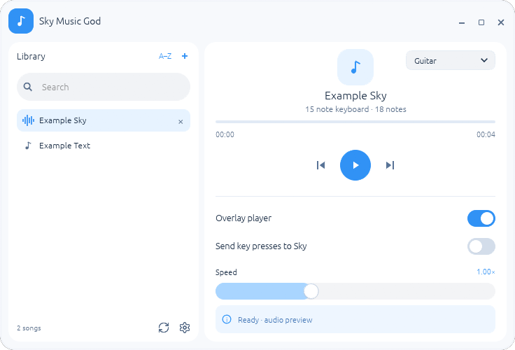
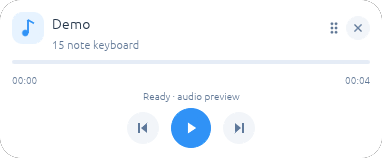

<p align="center">
  
</p>

<p align="center">
  <a href="https://github.com/hekogs/SkyMusicGod/releases/latest"></a>
  <a href="https://github.com/hekogs/SkyMusicGod/releases"></a>
  <a href="third_party/THIRD_PARTY_NOTICES.txt"></a>
</p>

<p align="center"><b>English</b> · <a href="README.ru.md">Русский</a></p>

Sky Music God is an unofficial music-sheet player for **Sky: Children of the Light** on Windows. It lets you listen to compositions locally with guitar or harp sounds, manage your music library, and optionally send keyboard inputs to the Sky game window. The main player and mini-player share **a single playback state**.

<p align="center">
  
</p>

<p align="center">
  
</p>


## Features

- **Audio preview:** two included 15-note sound banks, nylon guitar and folk harp.
- **Library:** import, search, sorting, custom song titles, deletion confirmation, and navigation to the previous or next track.
- **Controls:** Play/Pause, seeking, playback speed from 0.5× to 2.0×, and automatic playback of the next song.
- **Mini-player:** compact always-on-top window with playback controls and a seek bar.
- **Interface:** light and dark themes and 10 languages (Russian, English, Japanese, Simplified and Traditional Chinese, Malay, Brazilian Portuguese, Indonesian, Korean, and Filipino).
- **Optional Sky mode:** send keyboard notes to the active game window with a start delay from 0 to 10 seconds.

## Getting started

### Portable Windows version

Extract the **entire archive** to a writable folder and run `SkyMusicGod.exe`. No installer is required.

For audio preview, the `instruments/` folder must be located next to the EXE. Music sheets can be placed in `songs/` or imported through the interface.

```text
SkyMusicGod/
├── SkyMusicGod.exe
├── instruments/
│   ├── Guitar/
│   │   └── 0.ogg ... 14.ogg
│   ├── Harp/
│   │   └── 0.wav ... 14.wav
│   ├── LICENSE-CC0.txt
│   └── SOURCES.txt
├── songs/
└── settings.json        # created when settings are saved
```

### Audio preview

1. Import or select a compatible music sheet.
2. Select **Guitar** or **Harp**.
3. Leave **Send key presses to Sky** disabled.
4. Press Play in the main player or mini-player.

Both windows control **the same** song. The audio scheduler works independently of the window redraw rate.

### Sending notes to Sky

1. Select a sheet and enable **Send key presses to Sky**.
2. Set a delay of 0-10 seconds in Settings.
3. Press Play and switch to the game before the countdown ends.

The app uses Windows keyboard input and sends notes only when the Sky window is in the foreground. Playback pauses when the game loses focus. **Keyboard input is disabled on every launch**, regardless of saved settings.

> Game automation may conflict with its rules. Use this optional mode at your own discretion.

## Building from source

To build **Sky Music God** from source:

1. **Install the required tools:**
   - [Rust](https://rustup.rs/) (stable version, MSVC x64)
   - [Visual Studio Build Tools](https://visualstudio.microsoft.com/visual-cpp-build-tools/) (Desktop development with C++ workload)

2. **Download the source code:**

   Download the ZIP using **Code → Download ZIP** on GitHub, or clone the repository:

   ```powershell
   git clone <repository-URL>
   cd SkyMusicGod
   ```

3. **Build the application:**

   ```powershell
   cargo build --release --locked
   ```

4. **Prepare the application files:**

   ```powershell
   mkdir dist
   Copy-Item target\release\sky-music-god.exe dist\SkyMusicGod.exe
   Copy-Item assets\instruments dist\instruments -Recurse
   New-Item dist\songs -ItemType Directory
   ```

The finished application will be in the **`dist`** folder. Run `SkyMusicGod.exe`.

**Note:** Do not remove `vendor/egui-winit` - this dependency is required for building.

## Music-sheet formats

Compatible `.json`, `.txt`, and `.skysheet` files are supported.

## Project structure

```text
src/
  main.rs            Application state and windows
  main_view.rs       Main player and library
  mini_view.rs       Mini-player interface
  player.rs          Playback clock and state
  audio_preview.rs   Audio loading and scheduling
  song.rs            Music-sheet parsing
  windows_input.rs   Optional Sky keyboard input
  settings.rs        Local settings and backups
  i18n.rs            Interface translations
  theme.rs           Color themes
  ui_tokens.rs       Layout spacing and element sizes
  ui_icons.rs        Interface icons
  ui_text.rs         Text rendering
  window_shape.rs    Windows window management
assets/instruments/  CC0 sounds and source information
vendor/egui-winit/   Modified third-party dependency
third_party/        Third-party component licenses and notices
Cargo.toml           Rust configuration
Cargo.lock           Locked dependencies
```

## Troubleshooting

**No sound?** Check that `instruments/Guitar/` and `instruments/Harp/` exist next to the EXE, with 15 numbered files in each. Check the Windows audio output device and disable sending key presses to Sky.

**Song missing from the library?** Import the file through the interface or place a compatible sheet in `songs/` and refresh the library.

**Notes aren't being sent to Sky?** Enable this mode manually and make sure the game is in the foreground. Playback intentionally pauses when focus is lost.

## Local data and privacy

Songs and settings are stored locally. The app reads the `songs/` folder and saves settings in `settings.json` next to the EXE, with a backup for recovery after a crash. Local audio preview does not require an account or cloud service.

## Licenses

- **Guitar:** [Meta Open Sound — Nylon Guitar](https://github.com/facebookincubator/Meta-open-sound/tree/main/systems/instruments/meta-nylon-guitar).
- **Harp:** [Versilian Community Sample Library — Folk Harp](https://github.com/sgossner/VCSL/tree/master/Chordophones/Composite%20Chordophones/Folk%20Harp).

Rust dependencies retain their own licenses. The modified `egui-winit` is distributed under **MIT OR Apache-2.0**.

Sky Music God is an **unofficial fan-made application**, not affiliated with or endorsed by thatgamecompany. The Sky Music God source code is distributed under the MIT license (see [LICENSE](LICENSE)). The name *Sky: Children of the Light* and related trademarks belong to their respective owners.
