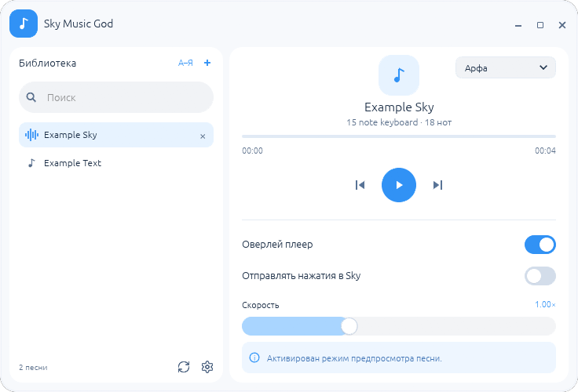

<p align="center">
  
</p>

<p align="center">
  <a href="https://github.com/hekogs/SkyMusicGod/releases/latest"></a>
  <a href="https://github.com/hekogs/SkyMusicGod/releases"></a>
  <a href="third_party/THIRD_PARTY_NOTICES.txt"></a>
</p>

<p align="center"><b>Русский</b> · <a href="README.md">English</a></p>

Sky Music God - неофициальный проигрыватель музыкальных листов для игры **Sky: Children of the Light** под Windows. Он позволяет слушать композиции локально со звуком гитары или арфы, управлять библиотекой и при необходимости отправлять нажатия клавиш в окно Sky. Основной и мини-плеер используют **единое состояние воспроизведения**.

<p align="center">
  
</p>

<p align="center">
  
</p>


## Возможности

- **Звуковое предпрослушивание:** два включённых набора по 15 нот, нейлоновая гитара и народная арфа.
- **Библиотека:** импорт, поиск, сортировка, собственные названия композиций, подтверждение удаления, переход к предыдущему или следующему треку.
- **Управление:** Play/Pause, перемотка, изменение скорости от 0,5× до 2,0× и автоматическое воспроизведение следующей композиции.
- **Мини-плеер:** компактное окно поверх других окон с кнопками управления и полосой перемотки.
- **Интерфейс:** светлая и тёмная темы и 10 языков (русский, английский, японский, упрощённый и традиционный китайский, малайский, бразильский португальский, индонезийский, корейский, филиппинский).
- **Дополнительный режим Sky:** отправка нот клавиатуры в активное окно игры с задержкой запуска от 0 до 10 секунд.

## Начало работы

### Портативная версия Windows

Распакуйте **весь архив** в папку с правами на запись и запустите `SkyMusicGod.exe`. Установщик не нужен.

Для звукового предпрослушивания папка `instruments/` должна находиться рядом с EXE. Музыкальные листы можно помещать в `songs/` или импортировать через интерфейс.

```text
SkyMusicGod/
├── SkyMusicGod.exe
├── instruments/
│   ├── Guitar/
│   │   └── 0.ogg ... 14.ogg
│   ├── Harp/
│   │   └── 0.wav ... 14.wav
│   ├── LICENSE-CC0.txt
│   └── SOURCES.txt
├── songs/
└── settings.json        # создаётся при сохранении настроек
```

### Предпрослушивание

1. Импортируйте или выберите совместимый музыкальный лист.
2. Выберите инструмент **Гитара** или **Арфа**.
3. Оставьте переключатель **«Отправлять нажатия в Sky»** выключенным.
4. Нажмите Play в основном или мини-плеере.

Оба окна управляют **одной** композицией. Звуковой планировщик работает независимо от частоты перерисовки окон.

### Отправка нот в Sky

1. Выберите лист и включите **«Отправлять нажатия в Sky»**.
2. Установите в настройках задержку 0–10 секунд.
3. Нажмите Play и переключитесь на игру до конца обратного отсчёта.

Программа использует клавиатурный ввод Windows и отправляет ноты, только если окно Sky находится на переднем плане. При потере фокуса воспроизведение приостанавливается. **Отправка клавиш отключена при каждом запуске** независимо от сохранённых настроек.

> Автоматизация игры, может противоречить её правилам. Используйте этот дополнительный режим на своё усмотрение.

## Сборка из исходников

Чтобы собрать **Sky Music God** из исходного кода:

1. **Установите необходимые инструменты:**
   - [Rust](https://rustup.rs/) (стабильная версия, MSVC x64)
   - [Visual Studio Build Tools](https://visualstudio.microsoft.com/visual-cpp-build-tools/) (компонент Desktop development with C++)

2. **Скачайте исходный код:**

   Загрузите ZIP через **Code → Download ZIP** на GitHub или клонируйте репозиторий:

   ```powershell
   git clone <URL-репозитория>
   cd SkyMusicGod
   ```

3. **Соберите приложение:**

   ```powershell
   cargo build --release --locked
   ```

4. **Подготовьте файлы программы:**

   ```powershell
   mkdir dist
   Copy-Item target\release\sky-music-god.exe dist\SkyMusicGod.exe
   Copy-Item assets\instruments dist\instruments -Recurse
   New-Item dist\songs -ItemType Directory
   ```

Готовое приложение будет находиться в папке **`dist`**. Запустите `SkyMusicGod.exe`.

**Примечание:** Не удаляйте `vendor/egui-winit` — эта зависимость необходима для сборки.

## Форматы музыкальных листов

Поддерживаются совместимые файлы `.json`, `.txt` и `.skysheet`. 

## Структура проекта

```text
src/
  main.rs            Состояние приложения и окна
  main_view.rs       Основной плеер и библиотека
  mini_view.rs       Интерфейс мини-плеера
  player.rs          Таймер и состояние воспроизведения
  audio_preview.rs   Загрузка и планирование звука
  song.rs            Разбор музыкальных листов
  windows_input.rs   Дополнительный ввод в Sky
  settings.rs        Локальные настройки и резервные копии
  i18n.rs            Переводы интерфейса
  theme.rs           Цветовые темы
  ui_tokens.rs       Отступы и размеры элементов
  ui_icons.rs        Иконки интерфейса
  ui_text.rs         Отображение текста
  window_shape.rs    Управление окнами Windows
assets/instruments/  Звуки CC0 и информация об источниках
vendor/egui-winit/   Изменённая сторонняя зависимость
third_party/       Лицензии и уведомления сторонних компонентов
Cargo.toml           Конфигурация Rust
Cargo.lock           Зафиксированные зависимости
```

## Устранение неполадок

**Нет звука?** Проверьте, что рядом с EXE существуют `instruments/Guitar/` и `instruments/Harp/` с 15 пронумерованными файлами. Проверьте устройство воспроизведения Windows и выключите режим отправки клавиш в Sky.

**Нет песни в библиотеке?** Импортируйте файл через интерфейс или поместите совместимый лист в `songs/` и обновите библиотеку.

**Не отправляются ноты в Sky?** Включите этот режим вручную и убедитесь, что игра находится на переднем плане. При потере фокуса программа намеренно приостанавливает воспроизведение.

## Локальные данные и конфиденциальность

Песни и настройки хранятся локально. Программа читает папку `songs/` и сохраняет настройки в `settings.json` рядом с EXE с резервной копией для восстановления после сбоя. Для локального предпрослушивания не требуется учётная запись или облачный сервис.

## Лицензии

- **Гитара:** [Meta Open Sound — Nylon Guitar](https://github.com/facebookincubator/Meta-open-sound/tree/main/systems/instruments/meta-nylon-guitar).
- **Арфа:** [Versilian Community Sample Library — Folk Harp](https://github.com/sgossner/VCSL/tree/master/Chordophones/Composite%20Chordophones/Folk%20Harp).

Зависимости Rust сохраняют собственные лицензии. Изменённый `egui-winit` распространяется по лицензии **MIT OR Apache-2.0**.

Sky Music God — **неофициальное фанатское приложение**, не связанное с thatgamecompany и не одобренное этой компанией. Код Sky Music God распространяется по лицензии MIT (файл [LICENSE](LICENSE)). Название *Sky: Children of the Light* и соответствующие товарные знаки принадлежат правообладателям.
